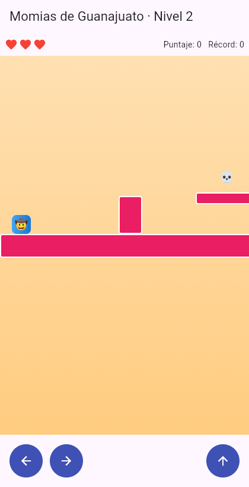
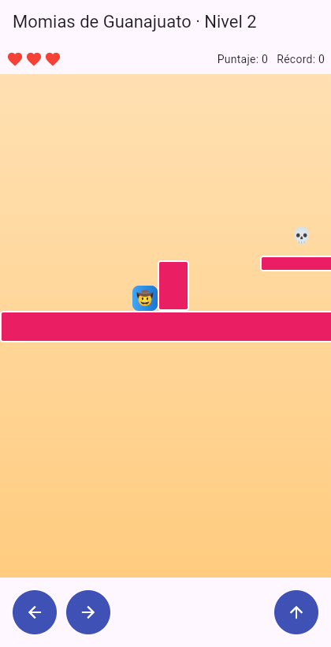
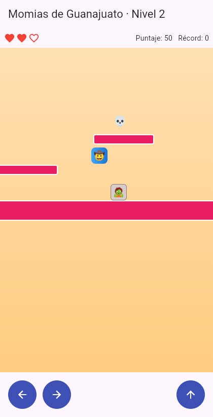
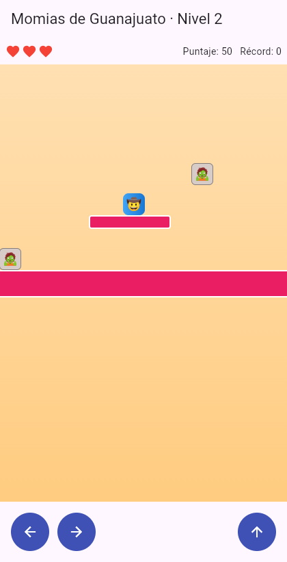
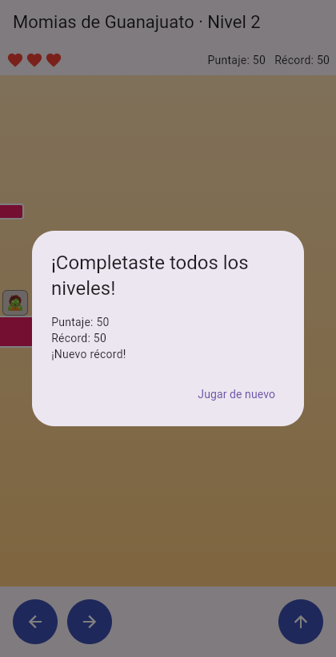

# Momias de Guanajuato: La Leyenda

Juego de plataformas en Flutter con física real, construido **100% con TDD** (Desarrollo Móvil Integral, proyecto complementario de práctica TDD). Se sigue el *Manual paso a paso con TDD*.

Un explorador 🤠 cruza los callejones de Guanajuato saltando entre plataformas, esquivando o derrotando momias 🧟 que patrullan, recolectando calaveritas 💀 de azúcar hasta llegar al **Callejón del Beso**.

## Mecánicas

- El personaje cae por gravedad y aterriza sobre plataformas.
- Controles: **← / →** (o A / D) para moverse y **↑ / Espacio / W** para saltar. También hay botones táctiles en pantalla.
- Las momias patrullan entre dos límites y invierten dirección al llegar a ellos.
- Saltar **encima** de una momia la derrota; chocar de lado quita una vida (se regresa al inicio).
- Cada calaverita suma 50 puntos.
- Llegar a la meta gana la partida; quedarse sin las 3 vidas la pierde.

## Arquitectura

Toda la física y las reglas viven en `lib/logica/` como **Dart puro** (sin widgets), probadas con TDD antes de escribir la interfaz.

```
lib/
  logica/
    rectangulo.dart      colisión AABB
    personaje.dart
    momia.dart           patrullaje
    calaverita.dart
    motor_fisica.dart    gravedad, salto, aterrizaje, límites, meta
    motor_combate.dart   stomp vs. golpe
    estado_juego.dart
    motor_juego.dart     orquesta todo el bucle
  presentation/
    juego_screen.dart    cámara lateral, sprites, controles
  main.dart
test/                    10 archivos, 49 pruebas (23 del manual + 26 de los retos)
```

## TDD: las 10 rondas (Rojo → Verde)

| Ronda | Tema | Archivo de prueba |
|---|---|---|
| 1 | Colisión entre rectángulos (AABB) | `rectangulo_test.dart` |
| 2 | Gravedad y salto | `motor_fisica_test.dart` |
| 3 | Aterrizar sobre una plataforma | `motor_fisica_test.dart` |
| 4 | Movimiento horizontal con límites | `motor_fisica_test.dart` |
| 5 | La momia patrulla entre dos límites | `momia_test.dart` |
| 6 | Combate: stomp vs. golpe | `motor_combate_test.dart` |
| 7 | Recolectar calaveritas | `motor_juego_test.dart` |
| 8 | Detectar la meta | `motor_fisica_test.dart` |
| 9 | Vidas y Game Over | `motor_juego_test.dart` |
| 10 | `MotorJuego` + prueba de integración (ganar) | `motor_juego_test.dart` |

Resultado de `flutter test` con solo las 10 rondas: **23 pruebas, todas en verde** (49 al sumar los retos, ver más abajo).

### Ajustes respecto al manual

Algunos datos de prueba del manual no podían pasar tal cual y se corrigieron:

- Prueba de aterrizaje: `y: 90` ya dejaba el pie dentro de la plataforma; se usó `y: 70` con `yAnterior: 65`.
- Prueba de stomp: `y: 68` no producía colisión; se usó `y: 70`.
- `Calaverita` es mutable, por lo que no se declara con `const` en el nivel.
- `clamp` devuelve `num`; se agregó `.toDouble()` en la cámara.
- Se agregó control por teclado (el manual solo traía botones táctiles).

## Capturas de pantalla (versión base, antes de los retos)

| Inicio | Saltando y calaverita (50 pts) |
|---|---|
|  |  |

| Vida perdida (Vidas: 2) | Victoria: Callejón del Beso |
|---|---|
|  |  |

| Game Over (Vidas: 0) |
|---|
|  |

## Cómo ejecutar

```bash
flutter pub get
flutter test
flutter run -d chrome
```

## Retos de extensión (los 5, hechos con TDD)

Cada reto se escribió primero como prueba y luego se implementó. Con ellos el proyecto pasa a **49 pruebas en verde**.

| Reto | Qué se hizo | Prueba |
|---|---|---|
| Colisión lateral con plataformas | `MotorFisica.resolverColisionLateral(personaje, plataformas, xAnterior)`, con el mismo patrón de "costura testable" que `resolverColisionConPiso`. `MotorJuego.mover()` la llama justo después de mover en horizontal. | `colision_lateral_test.dart` (5) |
| Corazones en el HUD | Widget `HudVidas` (corazón lleno por vida, vacío por vida perdida). | `hud_vidas_test.dart` (3) |
| Momia vertical | La misma clase `Momia` con `limiteArriba` / `limiteAbajo` / `velocidadY` y el constructor `Momia.vertical(...)`. | `momia_vertical_test.dart` (6) |
| Mejor puntaje con `shared_preferences` | `GestorMejorPuntaje` (lógica pura) + interfaz `AlmacenPuntaje`; `AlmacenPuntajePrefs` es la implementación con `shared_preferences`. Las pruebas usan un almacén en memoria. | `mejor_puntaje_test.dart` (5) |
| Segundo nivel | `Niveles.crear(i)` devuelve un `MotorJuego` nuevo: el nivel 2 es más largo (3200 px), con más plataformas, muros, 6 momias (una vertical) y 9 calaveritas. Reutiliza exactamente el mismo `MotorJuego`. | `niveles_test.dart` (7) |

Al ganar el nivel 1 aparece **Siguiente nivel**; el puntaje se acumula entre niveles y el récord se guarda al terminar cada partida.

Para depurar o tomar capturas, en web se puede abrir en un nivel y posición concretos: `?nivel=2&x=1700`.

### Capturas de los retos

| Nivel 2: arranque con muro | Colisión lateral: el muro frena al personaje |
|---|---|
|  |  |

| HUD con corazones (2 de 3) | Momia vertical (arriba a la derecha) |
|---|---|
|  |  |

| Nuevo récord guardado |
|---|
|  |
